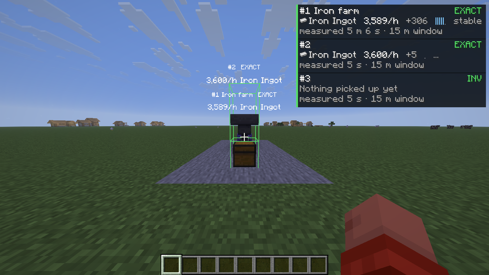

# Tickmark

Client-side farm rate meter for Minecraft 26.3 (Fabric). Mark a farm's output (a chest, a chest
wall, a hopper line or a collection area) and Tickmark shows how many items per hour it makes, per
item: the rate, the total, a per-minute sparkline and whether the rate is rising, stable or falling.
Rates use the game's tick clock, so a lagging server does not hide what the farm really does. No
server mod, no packets of its own.



## Use

- **U**: mark the container you look at as a counter. A container next to the counter you marked
  last joins it (a chest wall is one counter); **Shift + U** always starts a new one. Double chests
  count as one container.
- **I**: show or hide the HUD panel.
- `/tickmark mark box [x1 y1 z1 x2 y2 z2]`: mark an area (without numbers, press U on two corners).
- `/tickmark mark self`: count what you pick up yourself, for AFK farms where you collect.
- `/tickmark list`, `name <id> <name>`, `reset <id|all>`, `pause <id|all>`, `resume <id|all>`,
  `remove <id>`, `pin <id>`, `filter <id> <item>|clear`, `rule <id> collected|arrived|auto`.
- `/tickmark export <id|all>`: CSV per game minute and item in `config/tickmark/exports/`
  (columns `time,game_tick,item,count,measured_ticks,gap_ticks,method,counter`).
- `/tickmark config` or Mod Menu: settings (HUD corner and offset, which counters, items per
  counter, window 5 / 15 / 60 minutes, unit per minute / hour / day, sparkline, world labels).
- `/tm` is short for `/tickmark`. Keys can be changed in the controls menu.

Counters are kept per world (singleplayer save, or server address) in
`config/tickmark/worlds/<world>/counters.json` and survive leaving and rejoining. Every file the
mod writes is in `config/tickmark/`.

## What the client can see

A Minecraft client is not told what is in a container unless the player has it open, and is not told
why an entity disappeared. Tickmark picks the best method it can use and shows it on every counter.

| Where | Method | Tag | How good |
|---|---|---|---|
| Singleplayer, LAN host | Reads the containers (and items in a box) on the built-in server every second | `EXACT` | Exact |
| Server | Watches item entities: items that land in a hopper or container in the counter's area are counted; merges, pickups by players and mobs, and despawns are told apart | `ENTITY ~` | Estimate, within a few % in tests |
| Server, marked container | Open it, close it, open it later: the difference between visits is exact | `Opened: ... (exact)` line | Exact for the span between visits |
| Anywhere, `mark self` | Items the server says you picked up | `INV` | Exact for your own pickups |

The trust colour on the panel and the outline: green exact, yellow estimate, orange when items
had an unknown cause or more than a tenth of the window was a gap, grey when paused.

On a server Tickmark cannot see:

- items moved between containers by hoppers inside a closed system (no item entities): open the
  output now and then for the exact check;
- items created straight in a container (a crafter, a composter) without item entities;
- anything further than about 80 blocks from you, or outside the server's simulation distance
  (that time is a gap, not zero output).

## Time, lag and gaps

- Rates are per hour at 20 TPS: items divided by game ticks, times 72,000. If the server runs slow,
  the HUD adds the real-time output (for example "Server ran at 14.9 TPS: real output 26% lower").
- On a server the clock is the server's own game time (sent every 20 server ticks), and the current
  server speed is shown when it is slow.
- Time when the farm's chunks are not loaded or not ticking, the world is paused, the game is
  frozen (`/tick freeze`), or (on a server) the farm is out of sight, is a gap: it is left out of the
  rate instead of lowering it, and shows as dots in the sparkline and as "not loaded" in the HUD.

## Accuracy

Automated in-game tests build a farm with a command-block clock that drops one iron ingot every 20
game ticks into a hopper over a chest (3,600 per hour) and compare:

| Test | Measured | Error |
|---|---|---|
| Singleplayer, exact | 3,581 /h | 0.5% |
| Server, item entities | 3,584 /h | 0.5% |
| Server, opening the chest twice | 3,600 /h | 0.0% |
| Server at `/tick rate 10` | 3,600 /h at 20 TPS (1,801 /h real time) | 0.0% |
| Leaving until the chunks unload, then coming back (singleplayer / server) | 3,569 /h / 3,538 /h | 0.9% / 1.7% |

## Build

Needs JDK 25.

```
./gradlew build          # jar in build/libs, runs the JUnit tests
./gradlew runClient
```

### Automated in-game tests

Each test builds its rig with commands, logs `SELFTEST PASS` or `SELFTEST FAIL` and quits.

```
./gradlew runClient -Pselftest=exact --args="--quickPlaySingleplayer tmtest"
./gradlew runClient -Pselftest=gap   --args="--quickPlaySingleplayer tmtest"
./gradlew runClient -Pselftest=shots --args="--quickPlaySingleplayer tmtest --width 1600 --height 900"
```

`tmtest` is a flat creative world with cheats in `run/saves/`. For the server tests, start the test
server in `run-server/` (flat, offline, `server-port=25566`, `enable-rcon=true` on port 25576 with
password `tickmarktest`, `enable-command-block=true`) and connect:

```
./gradlew runServer
./gradlew runClient -Pselftest=entity --args="--username TickTester --quickPlayMultiplayer 127.0.0.1:25566"
./gradlew runClient -Pselftest=gap    --args="--username TickTester --quickPlayMultiplayer 127.0.0.1:25566"
```

See [PLAN.md](PLAN.md) for the design and what was checked in the 26.3 code.

## License

MIT. By Skaffa and Claude (Anthropic).
